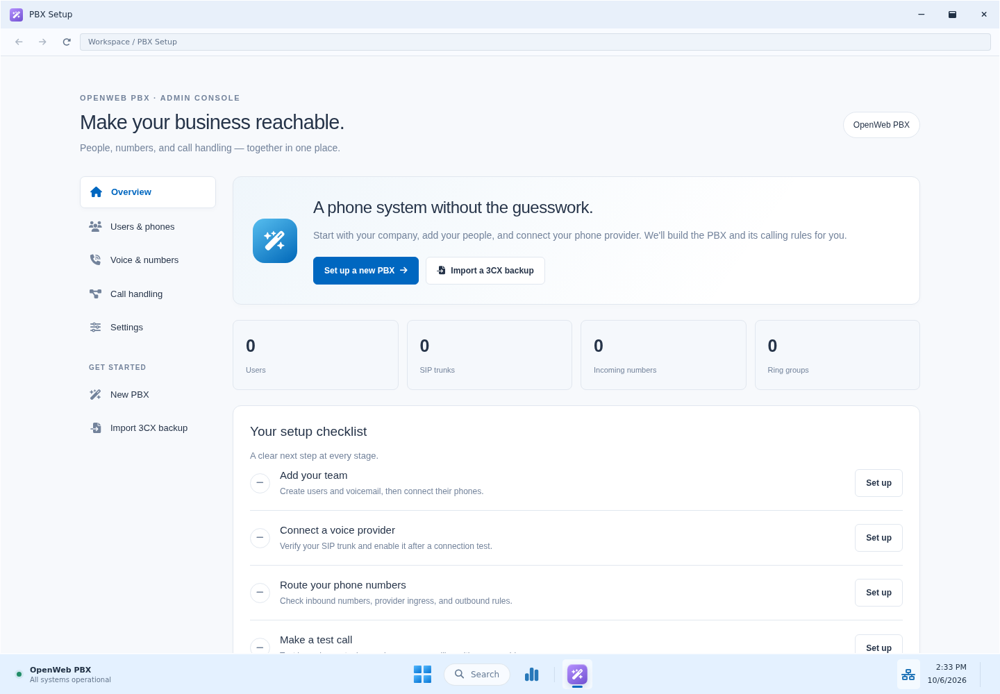

# OpenWeb PBX

**A free, open-source business phone system, built to make calling simpler.**

Run your own multi-tenant PBX with FreeSWITCH-powered calling, a Windows 11-inspired administration desktop and a native Android phone app. Give each business its own people, numbers and call rules, while managing the server in one place.

[Website](https://openwebpbx.com/) · [Downloads](#downloads-and-platforms) · [Get started](#get-started) · [Documentation](#documentation) · [Roadmap](3CX.md) · [Community](https://github.com/embire2/openwebpbx/discussions)



*The administration interface, showing an empty setup workspace. No customer data is pictured.*

## Our mission

OpenWeb PBX is a nonprofit, open-source project working towards a business phone system that anyone can install, understand and improve. Our first goal is to deliver the familiar, practical workflows people value in 3CX, then build beyond them with our community.

There is no OpenWeb software licence fee. You control your server and data; hosting, phone providers and optional external services have their own costs. Businesses, telecom providers, IT teams and self-hosting enthusiasts are welcome.

## Downloads and platforms

**Choose a component below.** Server, administration updates and phone apps have separate versions; the most recent GitHub release is not necessarily a complete server installer.

| Component | Public download | Platform and status |
|---|---|---|
| **PBX server** | [Debian 1.0.16](https://github.com/embire2/openwebpbx/releases/tag/v1.0.16) · [Install guide](docs/installing-1.0.16.md) | Complete server for **Debian 13 amd64**. Includes the local database, calling engine, web administration and background services. |
| **Administration update** | [Admin 1.0.19](https://github.com/embire2/openwebpbx/releases/tag/v1.0.19) · [Apply guide](docs/incoming-routing-1.0.19.md) | A focused incoming-call-routing update for supported Debian/core 1.0.16 installations. **Not a complete server installer.** |
| **OpenWebPBX Free Phone — Android** | [Android 1.0.18 APK](https://github.com/embire2/openwebpbx/releases/download/v1.0.18/openwebpbx-1.0.18-android.apk) · [Setup guide](docs/android-tenant-addresses-1.0.18.md) | Native **Android 9+** app. Requires a ready, registered `*.openwebpbx.com` tenant address and compatible server APIs. Mandatory on the hosted instance. Google Play publication is pending. |
| **OpenWebPBX Free Phone — Windows** | [Development source](https://github.com/embire2/openwebpbx/tree/feature/windows-free-phone-v1.0.0/clients/windows) · [Client plan](docs/windows-client-plan.md) | Native C# and WinUI 3 client in development for **Windows 11 and Windows Server 2025 Desktop Experience**. Calling, installation and update checks are in progress. No client download or Microsoft Store listing is available yet. |
| **Windows Server** | [Windows 1.0.20 ZIP](https://github.com/embire2/openwebpbx/releases/download/v1.0.20/openwebpbx-1.0.20-windows-x64.zip) · [Install guide](docs/installing-windows-1.0.20.md) | Complete implemented server suite for **Windows Server 2025 x64 with Desktop Experience**, including the local database, calling, web administration, Phone Health, conferences, backups, updater and native server manager. |

**Windows Server 1.0.20 is available.** Fresh installation, two-way software calling, browser audio/video, encrypted backup and replacement-server restore pass against the published package. The signed next-version upgrade, automatic restart and deliberate-failure rollback also pass. Earlier Windows installations still need the separately qualified legacy transition; real reboot and external phone/provider checks remain open. Meetings after an instance restore still need their separate media check. The complete Debian server remains 1.0.16, with a newer full package still under qualification. See the [Windows release record](docs/release-1.0.20-qualification.md) for evidence and limits.

**Android compatibility:** installing 1.0.18 alone does not add tenant-address support to a stock Debian 1.0.16 server. Use the Android version supplied with your server release until its required server support is installed. The hosted instance already has that support; self-hosted tenant-address support is included in Windows Server 1.0.20. A rebuilt complete Debian installer is still under qualification. The [1.0.18 guide](docs/android-tenant-addresses-1.0.18.md) explains the hosted rollout and the separate Debian update-feed compatibility patch. Install app updates over the existing app to retain accounts and settings.

Release pages include checksums, signed update metadata and corresponding source. [All releases](https://github.com/embire2/openwebpbx/releases) · [Download catalogue](https://openwebpbx.com/#downloads) · [Updates and recovery](docs/updates.md)

## Get started

### Windows Server 2025

Download the Windows ZIP and its `SHA256SUMS`, verify the checksum, extract the complete archive and open **Start-OpenWebPBX.cmd**. Choose **Setup**, enter the server hostname and administrator details, and follow the first-call checks. Setup installs PostgreSQL locally; tenants do not need separate databases. Follow the [Windows guide](docs/installing-windows-1.0.20.md) for certificates, network access and backup/restore. Use the upgrade guide for an installed PBX.

### Debian 13

1. **Prepare a Debian 13 amd64 server.** Point your PBX hostname at it and obtain a trusted HTTPS certificate. Download the complete Debian archive above, verify its `SHA256SUMS` entry and extract it into an empty directory.
2. **Install the server.** Run the command below as root, using your hostname, public IP and certificate paths. Setup prompts for the administrator password and installs PostgreSQL on the same machine; tenants do not configure databases.
3. **Add your team and test a call.** Sign in at your server's HTTPS address, open **Users**, connect two phones, and call between them. Add your phone provider under **Voice & Chat**, set your incoming destinations and outbound rules, then test an incoming and outgoing call before moving live numbers.

```sh
./install.sh --domain pbx.example.com --address YOUR_SERVER_IP --email admin@example.com \
  --certificate /path/to/fullchain.pem --certificate-key /path/to/privkey.pem
```

The [installation guide](docs/installing-1.0.16.md) covers certificates, local trials and existing installations. Use the documented updater for an installed PBX; fresh setup protects existing installations from replacement.

For Android, use **Users → Phone Provisioning → Connect Android App · QR Code** on a compatible server and scan the single-use setup code. Current hosted accounts first confirm their tenant address. Read the [Android guide](docs/android.md) for permissions, supported controls and incoming-call setup.

## What you can build with it

- **Business calling:** SIP providers, extensions, incoming numbers, outbound rules, ring groups, digital receptionists and voicemail. [Calling guide](docs/core-calling.md)
- **A PBX for multiple businesses:** separate tenant workspaces, departments, staff roles and routing, with one local database per installation. [Users and departments](docs/users-and-departments.md) · [Staff permissions](docs/department-staff.md)
- **Practical call handling:** office hours, breaks, holidays, temporary Open/Closed overrides and a routing preview; receptionist transfer, pickup and parking; queues, callbacks and a wallboard. [Routing](docs/core-calling.md#opening-hours-and-routing) · [Switchboard](docs/core-calling.md#receptionist-switchboard) · [Queues](docs/core-calling.md#queues-callbacks-and-wallboard)
- **Native mobile calling:** Android voice and optional colleague-to-colleague video, a company directory, recent calls, visible Hold/Resume, transfers, personal settings and multiple tenant profiles on compatible servers. [Android](docs/android.md) · [Video](docs/android-video.md)
- **Meetings and useful services:** hosted audio/video conferences, UK default voice prompts, own voicemail on **121**, a GMT+2 talking clock on **1026** and optional Call Me Back services. [Meet](docs/meet.md) · [Voicemail and clock](docs/voicemail-and-clock.md) · [Call Me Back](docs/call-me-back.md)
- **Manageable operations:** encrypted scheduled backups, retention and restore, global outgoing mail, and signed downloads with call-aware update policies and recovery. [Backups](docs/backups.md) · [Updates](docs/updates.md)
- **Phone Health & Recovery:** see which phones and providers need attention, identify verified office security blocks and request controlled recovery. Available in Windows Server 1.0.20 and live on hosted Debian through a focused patch. The complete Debian installer still needs rebuilding and acceptance. [Feature guide](docs/phone-health.md)

The desktop provides familiar windows, a searchable Start menu, a centred taskbar and light/dark themes. Administration stays in your browser; the Android app handles calls natively.

## Moving from 3CX

The supported **3CX V20 backup importer** preserves restored extension numbers, separate authentication IDs, password bytes and supported call-handling settings. Review **Restore Report** for unsupported items and use the [desk-phone migration guide](docs/desk-phone-handover.md) before changing phone domains. A successful import still needs real phone and provider checks before a cutover.

OpenWeb PBX is independently developed software. Proprietary 3CX apps and hosted services are not supplied or made compatible by importing a backup. Complete 3CX feature parity is our development goal; the [roadmap](3CX.md) currently tracks **133 goals: 21 accepted, 72 partial and 40 planned**.

## Current status

The published Debian release has documented installation, signed-update/recovery, encrypted restore and software calling checks. The hosted ring-group repair has also been confirmed on an actual outside call: the phones ring, the caller hears ringing and both parties hear each other after answering. Hosted trunk Options and incoming routing are documented in the [core status](docs/core-system-status.md).

Hosted Debian now also provides Phone Health, persistent incident banners and optional administrator emails through the global outgoing-mail queue. Recovery is limited to a verified office sign-in block, with explicit owner confirmation and security-service acknowledgment. [Operating guide and tested limits](docs/phone-health.md).

These results cover their recorded test scope. Broader physical phone/camera coverage, restrictive networks and TURN, measured meeting capacity, carrier cutovers and Google Play acceptance remain open. [Feature coverage](docs/feature-coverage.md) records evidence and limitations; [release qualification](docs/release-1.0.20-qualification.md) tracks the next installers. Recent development details belong there and in [release notes](https://github.com/embire2/openwebpbx/releases), rather than in the installation steps.

## Documentation

| Start here | Administration and operation | Development |
|---|---|---|
| [Windows installation](docs/installing-windows-1.0.20.md) · [Debian installation](docs/installing-1.0.16.md) | [Provider and first calls](docs/core-calling.md) | [Roadmap](3CX.md) |
| [Android setup](docs/android.md) | [Desk-phone migration](docs/desk-phone-handover.md) | [Feature coverage](docs/feature-coverage.md) |
| [Remote Yealink W60B](docs/yealink-w60b-remote.md) | [Phone health and recovery](docs/phone-health.md) · [Backups](docs/backups.md) | [Core system status](docs/core-system-status.md) |
| [Tenant addresses](docs/tenant-phone-accounts.md) | [Meetings](docs/meet.md) | [Windows calling-client plan](docs/windows-client-plan.md) |

## Help shape OpenWeb PBX

Try it in a test environment, share your experience in [Discussions](https://github.com/embire2/openwebpbx/discussions), report a reproducible problem in [Issues](https://github.com/embire2/openwebpbx/issues), or contribute a focused pull request against **`customization`**, the development/default branch. Useful contributions include phone/provider testing, documentation, translations, accessibility and code.

Include the server/app version, expected behaviour and a small reproduction. Remove credentials, phone numbers, account data and private logs before posting. Check the roadmap and discuss a substantial change before building it. [Source history](https://github.com/embire2/openwebpbx/commits/customization/) retains both upstream and OpenWeb development history; its commit count is not a count of original OpenWeb changes.

## Origins, licences and credits

OpenWeb PBX began from [FusionPBX](https://github.com/fusionpbx/fusionpbx), originally its stable `5.6` branch, and is powered by [FreeSWITCH](https://github.com/signalwire/freeswitch). We acknowledge those projects and their contributors. This project's branding, roadmap and releases are maintained by OpenWeb; original history, copyright notices and licences remain intact. [Repository independence](docs/repository-independence.md) records the pending GitHub fork-network detachment and the owner request needed to preserve releases and history.

The server retains the [Mozilla Public License 1.1](LICENSE) and existing component licences. The native Android client in [mobile/android](mobile/android/) is **AGPL-3.0-or-later**, with its own component notices and corresponding source. Additional distribution notices are in [packaging/licenses](packaging/licenses/). Operational paths such as `/etc/fusionpbx` remain for installation compatibility.

The bundled hold track is Seth_Makes_Sounds' **Lofi Beat Loop Schmoop**, released under CC0. [Music credits and provenance](docs/music-on-hold.md). OpenWeb PBX is not affiliated with or endorsed by 3CX.

[Privacy](https://openwebpbx.com/privacy) · [Terms](https://openwebpbx.com/terms) · [Delete account/data](https://openwebpbx.com/delete) · [Cookie choices](https://openwebpbx.com/cookies) · [Company information](https://openwebpbx.com/legal)
