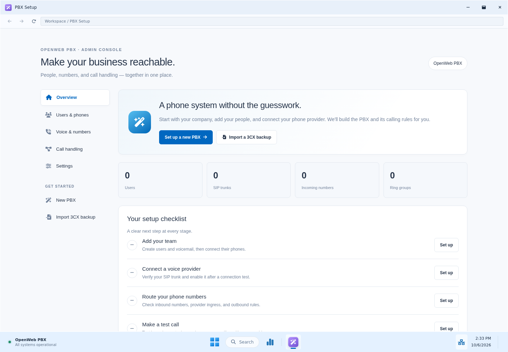

# OpenWeb PBX


**A free, open-source business phone system, built to make calling simpler.**

Run your own multi-tenant PBX with FreeSWITCH-powered calling, a Windows 11-inspired administration desktop and a native Android phone app. Give each business its own people, numbers and call rules, while managing the server in one place.

[Website](https://openwebpbx.com/) · [Downloads](#downloads-and-platforms) · [Get started](#get-started) · [Documentation](#documentation) · [Roadmap](3CX.md) · [Community](https://github.com/embire2/openwebpbx/discussions)



*The administration interface, showing an empty setup workspace. No customer data is pictured.*

## Our mission

OpenWeb PBX is a nonprofit, open-source project working towards a business phone system that anyone can install, understand and improve. Our first goal is to deliver the familiar, practical workflows people value in 3CX, then build beyond them with our community.

There is no OpenWeb software licence fee. You control your server and data; hosting, phone providers and optional external services have their own costs. Businesses, telecom providers, IT teams and self-hosting enthusiasts are welcome.

## Downloads and platforms

Choose the **server** for your operating system, then a compatible phone app. Components have separate versions and signed feeds. Linux can move ahead while Windows completes its own tests, and Windows can catch up later; matching version numbers do not establish compatibility. [Independent platform releases](docs/independent-platform-releases.md).

[Debian-to-Windows change ledger](docs/debian-windows-sync.md) tracks each new server feature and fix, its deployment status and the checks required for Windows catch-up.

**Latest releases** · Debian **1.0.29** · Windows Server **1.0.27** · Android **1.0.19**. Each platform has its own source, signed feed and qualification.

| Component | Public download | Platform and status |
|---|---|---|
| **Debian server** | [Debian 1.0.29 archive](https://github.com/embire2/openwebpbx/releases/download/v1.0.29/openwebpbx-1.0.29-debian13-amd64.tar.gz) · [Checksums](https://github.com/embire2/openwebpbx/releases/download/debian-v1.0.29/SHA256SUMS) · [Install guide](docs/installing-1.0.29.md) | **Complete standalone installer for clean Debian 13 amd64. No previous OpenWeb PBX required.** Includes local database setup, calling, web/API administration, system prompts, updater and background services. |
| **OpenWebPBX Free Phone — Android** | [Android 1.0.19 APK](https://github.com/embire2/openwebpbx/releases/download/v1.0.19/openwebpbx-1.0.19-android.apk) · [Release notes](https://github.com/embire2/openwebpbx/releases/tag/android-v1.0.19) · [Setup guide](docs/android-tenant-addresses-1.0.18.md) | Native **Android 9+** app with a five-second logo launch screen; calls and updates bypass branding. Registered `*.openwebpbx.com` tenant addresses and compatible APIs are required. Managed updates require server 1.0.20+. Mandatory on the hosted instance. Google Play publication is pending. |
| **OpenWebPBX Free Phone — Windows** | [Development source](https://github.com/embire2/openwebpbx/tree/feature/windows-free-phone-v1.0.0/clients/windows) · [Client plan](docs/windows-client-plan.md) | Native C# and WinUI 3 client in development for **Windows 11 and Windows Server 2025 Desktop Experience**. Development-package install/update/relaunch checks pass; calling and production distribution remain under qualification. No client download or Microsoft Store listing is available yet. |
| **Windows Server** | [Windows 1.0.27 ZIP](https://github.com/embire2/openwebpbx/releases/download/windows-v1.0.27/openwebpbx-1.0.27-windows-x64.zip) · [Install guide](docs/installing-windows-1.0.27.md) | **Complete standalone installer for Windows Server 2025 x64 with Desktop Experience. No previous OpenWeb PBX or separate PBX patch required.** Includes local PostgreSQL setup, native Core/WinUI manager, tenant setup, web/API administration, backups, system prompts and the current ordered updater. |

**Historical Windows updater repair:** [Retained repair ZIP](https://github.com/embire2/openwebpbx/releases/download/windows-v1.0.23/openwebpbx-1.0.23-windows-updater-repair.zip) · [Guide](docs/windows-upgrade-path-repair.md) · [Checksums](https://github.com/embire2/openwebpbx/releases/download/windows-v1.0.23/windows-updater-repair-SHA256SUMS). The original **1.0.21 → 1.0.22 → 1.0.23** sequence retains its separate qualification. Older installed clients use the documented signed upgrade path; this historical repair is not a prerequisite for a fresh Windows 1.0.27 installation, which includes the current updater.

**Install the complete package directly on a clean supported server.** Debian 1.0.29 and Windows Server 1.0.27 include local PostgreSQL setup and the updater. Both use the [same registration wizard](https://openwebpbx.com/wizard).

**Updating an existing PBX:** use its Updates page to keep credentials, QR identities, recordings and routes. Check the supported starting versions and recovery procedure in the [Debian qualification](docs/release-1.0.29-local-qualification.md) or [Windows qualification](docs/release-windows-1.0.27-qualification.md). Android remains **1.0.19**; install its updates over the existing app to retain accounts.

Historical: [Admin 1.0.19](https://github.com/embire2/openwebpbx/releases/tag/v1.0.19) is an incoming-routing administration update for supported Debian/core 1.0.16 installations, **not a complete server installer**. [Apply guide](docs/incoming-routing-1.0.19.md).

Release pages provide checksums, signed metadata and corresponding source. [All releases](https://github.com/embire2/openwebpbx/releases) · [Download catalogue](https://openwebpbx.com/#downloads) · [Updates and recovery](docs/updates.md)

**Debian 1.0.29** improves upgrades on slow storage, uses private disk storage for large 3CX imports and lets administrators record failed or blocked First Calls tests. It includes support for the inspected 3CX V20 Update 10 build `20.0.10.1801` alongside Update 9 build `20.0.9.995`. The exact package passed an isolated clean installation and a signed upgrade from 1.0.27. [Release](https://github.com/embire2/openwebpbx/releases/tag/debian-v1.0.29) · [Qualification](docs/release-1.0.29-local-qualification.md).

**Windows 1.0.27 published 2026-11-19T17:13:55Z:** complete standalone [release](https://github.com/embire2/openwebpbx/releases/tag/windows-v1.0.27) · [installation guide](docs/installing-windows-1.0.27.md) · [qualification](docs/release-windows-1.0.27-qualification.md) · [checksums](https://github.com/embire2/openwebpbx/releases/download/windows-v1.0.27/SHA256SUMS). No previous PBX or separate repair is required for a new server. Full ZIP **643,869,682 bytes**, SHA-256 `fd02d054ae21b06ca6be7945e515513d02f1c4989851b83e395e53a8103a88fb`; frozen package source `ccccfe56ed7012455e1cf00395407389a7226daf`. Native Core, updater and WinUI manager are 1.0.27.0, built from `9f6a0ac42999614755ee0838c0660324970f11c1`; all **90 compiled source inputs** remain byte-identical in the package source.

**Debian 1.0.27 published 2026-11-17T16:12:26Z:** complete standalone [release](https://github.com/embire2/openwebpbx/releases/tag/debian-v1.0.27) · [installation guide](docs/installing-1.0.27.md) · [checksums](https://github.com/embire2/openwebpbx/releases/download/debian-v1.0.27/SHA256SUMS). No previous PBX installation is required. Archive SHA-256 `fa771a66999ec2811212ed452588025c5cbe78b0502b8afd7794588c0e236198`; frozen source `72bb5406af4c057acb5ee4eddfd9d861d20d345f`.

**Debian 1.0.26 published 2026-11-16T18:37:48Z:** [release](https://github.com/embire2/openwebpbx/releases/tag/debian-v1.0.26) · [installation guide](docs/installing-1.0.26.md) · [checksums](https://github.com/embire2/openwebpbx/releases/download/debian-v1.0.26/SHA256SUMS). Archive SHA-256 `3f951c94b2454e4f232f07126d3782ae8a2fa6e9d51fed270f2c27112963cfb5`; frozen Debian source `5b60f57458ab336cc5c9e928128054b8d9491bba`. Windows remains 1.0.23 with its separate updater repair; Android remains 1.0.19.

**Windows 1.0.23 published 2026-11-05T20:43:14Z:** [release](https://github.com/embire2/openwebpbx/releases/tag/windows-v1.0.23) · [installation guide](docs/installing-windows-1.0.23.md) · [checksums](https://github.com/embire2/openwebpbx/releases/download/windows-v1.0.23/SHA256SUMS). ZIP SHA-256 `badc4326b48d1e7953990eb382f598602bb23bd068ca27c42abf22c25ce10907`; frozen Windows source `e1aaad63f99ac3b11714d9d0cd3f2a085778688f`. Hosted 1.0.24 features and calling corrections retain their separate source and qualification.

**Build from the matching source.** Debian 1.0.29 uses [`debian-v1.0.29`](https://github.com/embire2/openwebpbx/tree/debian-v1.0.29) at `96441f3484c75d265c88b80becb1e9f71bdbb6f1`. [Debian application source](https://github.com/embire2/openwebpbx/releases/download/debian-v1.0.29/openwebpbx-1.0.29-debian-source.tar.gz). Windows 1.0.27 uses [`windows-v1.0.27`](https://github.com/embire2/openwebpbx/tree/windows-v1.0.27) at `ccccfe56ed7012455e1cf00395407389a7226daf`. [Windows application source](https://github.com/embire2/openwebpbx/releases/download/windows-v1.0.27/openwebpbx-1.0.27-windows-source.tar.gz) · [Windows native build evidence](docs/release-windows-1.0.27-qualification.md). Corresponding FreeSWITCH sources are available separately. [Debian engine source](https://github.com/embire2/openwebpbx/releases/download/v1.0.22/openwebpbx-1.0.22-debian13-engine-source.tar.gz) · [Windows engine source](https://github.com/embire2/openwebpbx/releases/download/v1.0.16/openwebpbx-1.0.16-engine-source.tar.gz).

## Get started

### Windows Server 2025

1. Prepare **Windows Server 2025 x64 with Desktop Experience**, administrator access and a reachable public IP. Download the full ZIP, verify its `SHA256SUMS` entry and extract it to a short folder readable by your installing account.
2. Open **Start-OpenWebPBX.cmd → Setup**, select **Managed OpenWeb PBX setup (recommended)** and enter your local PBX administrator details. After installation, choose **Finish registration**, verify your OpenWeb account and select an available `company.openwebpbx.com` address.
3. Sign in at that address, complete **Create my PBX**, add people in **Users** and test two phones. Configure your provider in **Voice & Chat**. [Windows installation, certificates and backups](docs/installing-windows-1.0.27.md).

**Existing Windows updaters:** Windows 1.0.27 includes the current ordered updater, checks every five minutes and keeps calling services available until an update is installed. Existing-data updates retain signature, compatibility, active-call, backup and recovery checks. The retained original Windows 1.0.23 package and its [historical ordered-updater repair](docs/windows-upgrade-path-repair.md) keep their original evidence. See the [Windows27 qualification](docs/release-windows-1.0.27-qualification.md) for supported update paths; none is a prerequisite for a fresh installation.

### Debian 13

1. Prepare a clean **Debian 13 amd64** server; **no previous PBX is needed**. Use a server with a reachable public IP. Verify the complete archive's checksum and extract it into an empty private directory.
2. Run this as root, choose your local administrator password, then follow the setup link to verify your account and choose a tenant address. Managed DNS and trusted HTTPS are prepared; calling starts after registration.

```sh
./install.sh --bootstrap-registration --address YOUR_PUBLIC_IP --email admin@example.com --stun
```

3. Sign in, add people, connect two phones and test calling. Configure provider destinations and outgoing rules before moving live numbers. [Debian guide](docs/installing-1.0.29.md).

Optional: `./install.sh --check` validates the complete package and machine without installing anything. Fresh setup protects existing installations; use their Updates page to preserve existing data. The OpenWeb account and local administrator are separate sign-ins. Configure **Outgoing Mail** before emailing invitations.

### Connect Android with a QR code

Use **Users → Phone Provisioning → Connect Android App · QR Code**. **Hosted accounts, Debian 1.0.23, 1.0.26, 1.0.27 and 1.0.29, and Windows Server 1.0.22, 1.0.23 and 1.0.27 provide reusable QR codes** containing the tenant address. Viewing, emailing, exporting, scanning and password changes preserve the code. Explicit **Reset QR code** invalidates earlier codes/files while keeping connected devices. The older published **Debian 1.0.22 archive retains its original invitation behavior**; it does not acquire the hosted correction automatically. [Android guide](docs/android.md) · [Tenant addresses](docs/android-tenant-addresses-1.0.18.md).

## What you can build with it

- **Business calling:** extensions, providers, numbers, rules, ring groups, receptionists and voicemail. [Calling](docs/core-calling.md) · [Trunk numbers](docs/trunk-options.md#add-an-incoming-number)
- **Multiple businesses:** tenant workspaces, departments, staff roles and routing. [Users](docs/users-and-departments.md) · [Permissions](docs/department-staff.md)
- **Call handling:** office hours, holidays, overrides, transfers, pickup, parking, queues, callbacks and wallboard. [Routing](docs/core-calling.md#opening-hours-and-routing) · [Switchboard](docs/core-calling.md#receptionist-switchboard) · [Queues](docs/core-calling.md#queues-callbacks-and-wallboard) · [Schedules](docs/company-office-hours.md)
- **Audio and services:** recorded greetings, Keoma narration, voicemail **121** and GMT+2 clock **1026**. [Greetings](docs/greetings.md) · [Voicemail/clock](docs/voicemail-and-clock.md) · [Call Me Back](docs/call-me-back.md)
- **Phones and meetings:** Android voice, optional colleague video, directory, Hold/Resume, transfers and tenant profiles; hosted conferences. [Android](docs/android.md) · [Video](docs/android-video.md) · [Meet](docs/meet.md)
- **Reseller operations in both Debian and Windows servers:** private templates with provider presets, scoped client workspaces, extension/call packages, priced resource requests, tenant recovery and revocable API keys. [Guide](docs/reseller-1.0.25.md) · [API reference](https://openwebpbx.com/api-docs)
- **Operations:** encrypted backups/restore, outgoing mail, call-aware signed updates and controlled recovery for verified office blocks. [Backups](docs/backups.md) · [Full-media recovery checks](docs/backup-recovery-2026-11-09.md) · [Updates](docs/updates.md) · [Phone Health](docs/phone-health.md)

The browser desktop has windows, Start-menu search, a centred taskbar and themes. Android handles calls natively. [Feature scope and limits](docs/feature-coverage.md).

## Moving from 3CX

The supported **3CX V20 backup importer** preserves restored extension numbers, separate authentication IDs, password bytes and supported call-handling settings. Review **Restore Report** for unsupported items and use the [desk-phone migration guide](docs/desk-phone-handover.md) before changing phone domains. A successful import still needs real phone and provider checks before a cutover.

OpenWeb PBX is independently developed software. Proprietary 3CX apps and hosted services are not supplied or made compatible by importing a backup. Complete 3CX feature parity is our development goal; the [roadmap](3CX.md) currently tracks **133 goals: 21 accepted, 72 partial and 40 planned**.

## Current status

<!-- RELEASE123-STATUS-BEGIN -->
**Debian 1.0.29 is published.** The full installer sets up a fresh PBX on Debian 13 amd64 with its own PostgreSQL database. [Release](https://github.com/embire2/openwebpbx/releases/tag/debian-v1.0.29) · [Installation](docs/installing-1.0.29.md) · [Qualification](docs/release-1.0.29-local-qualification.md).

**Windows 1.0.27 is published.** Install the complete server on Windows Server 2025 x64 with Desktop Experience, with no earlier PBX or separate repair. The complete suite includes local PostgreSQL setup, the native manager, current ordered updater, guided registration, web/API administration, dashboard and tenant recovery, reseller templates/packages, personal and department-scoped API keys, and system prompts. [Installation](docs/installing-windows-1.0.27.md) · [Qualification](docs/release-windows-1.0.27-qualification.md). Android remains 1.0.19.
**Hosted PBX 1.0.29.** The web application, Core and updater are live at `call.openweb.co.za`. [Hosted rollout verification](docs/release-1.0.29-local-qualification.md#hosted-rollout).

**Hosted PBX features.** Use Dashboard or Tenant Admin → **Backup & Restore**, **Packages & Resources** and **API Keys** for encrypted recovery, scoped integrations, provider-ready templates, extension and call allowances, and priced capacity requests. Billing approvals grant capacity. Payment collection stays external. [Reseller guide](docs/reseller-1.0.25.md) · [API v2](docs/reseller-api-v2.md) · [Full-media recovery evidence](docs/backup-recovery-2026-11-09.md).

**Manage the PBX by API:** the [searchable API reference](https://openwebpbx.com/api-docs) and [OpenAPI download](https://openwebpbx.com/api-openapi-v2.json) cover tenant/reseller, PBX, department and personal workflows: 197 paths / 250 HTTP operations. Create a key from **API Keys** in Tenant Admin, PBX Administration or My PBX; **API Documentation** is linked alongside it. Permissions follow the current account, selected tenant/PBX and department role on every request. End users manage their own calls, voicemail, availability, contacts and app setup. Hosted base: `https://openwebpbx.com/api/v2`; self-hosted servers use their own address. [1.0.26 scope and verification](docs/api-1.0.26.md). Debian and Windows standalone bundles provide these workflows through their own server addresses.

The hosted 1.0.24 calling correction also respects restored provider media settings and distinguishes early media from an answered call. The reported outside call now connects from Android with user-confirmed sound both ways. [Fix and validation](docs/outgoing-calls-1.0.24.md).
<!-- RELEASE123-STATUS-END -->

The [1.0.22 Debian](docs/release-1.0.22-qualification.md) and [Windows](docs/release-windows-1.0.22-qualification.md) records retain their original acceptance and reused-component scope. [Hosted status](docs/core-system-status.md), [routing changes](docs/did-routing-1.0.23.md) and [release history](https://github.com/embire2/openwebpbx/releases) provide the details. Hosted corrections do not rewrite older archives. Physical phones/cameras, carriers, restrictive networks/TURN, capacity, universal email delivery and Store acceptance retain their [recorded limits](docs/feature-coverage.md).

## Automate tenant setup

The hosted [Tenant API](https://openwebpbx.com/api-docs) provides verified-account and isolated-template PBX creation, scoped keys, quotas, idempotency and managed-address readiness. [Integration guide](docs/tenant-api.md) · [OpenAPI 3.1](docs/tenant-api.openapi.json).

Manage existing hosted CloudPBXs through the [tenant administration API](https://call.openweb.co.za/api-docs). In **API Keys**, choose **Full tenant administration** for access to the selected tenant’s current and future PBXs. [API key and integration guide](docs/tenant-admin-api.md).

The [public wizard](https://openwebpbx.com/wizard) connects your own Debian/Windows server to an owner and tenant address; the PBX/database stay local. [Self-install registration](docs/self-install-onboarding.md) · [First-boot API](https://openwebpbx.com/wizard-openapi.json).

Webhotel's Debian 13 image is available in qualified locations, with encrypted, owner-scoped access to initial connection details. Hosting costs are separate from free software. [Hosting availability, credentials and limits](docs/webhotel-onboarding.md).

## Documentation

| Start here | Administration and operation | Development |
|---|---|---|
| [Windows installation](docs/installing-windows-1.0.27.md) · [Debian installation](docs/installing-1.0.29.md) | [Provider and first calls](docs/core-calling.md) | [Roadmap](3CX.md) |
| [Android setup](docs/android.md) | [Desk-phone migration](docs/desk-phone-handover.md) | [Feature coverage](docs/feature-coverage.md) |
| [Remote Yealink W60B](docs/yealink-w60b-remote.md) | [Phone health and recovery](docs/phone-health.md) · [Backups](docs/backups.md) | [Core system status](docs/core-system-status.md) · [Independent platform releases](docs/independent-platform-releases.md) |
| [Tenant addresses](docs/tenant-phone-accounts.md) | [Meetings](docs/meet.md) | [Windows calling-client plan](docs/windows-client-plan.md) |

## Help shape OpenWeb PBX

Try a test installation, join [Discussions](https://github.com/embire2/openwebpbx/discussions), report reproducible [Issues](https://github.com/embire2/openwebpbx/issues), or send focused contributions to **`customization`**, the development/default branch. Include versions and a small reproduction; remove credentials, numbers and private logs. Discuss substantial changes first. [History](https://github.com/embire2/openwebpbx/commits/customization/) includes upstream and OpenWeb work.

## Origins, licences and credits

OpenWeb PBX began from [FusionPBX](https://github.com/fusionpbx/fusionpbx), originally its stable `5.6` branch, and is powered by [FreeSWITCH](https://github.com/signalwire/freeswitch). We acknowledge those projects and their contributors. This project's branding, roadmap and releases are maintained by OpenWeb; original history, copyright notices and licences remain intact. [Repository independence](docs/repository-independence.md) records the pending GitHub fork-network detachment and the owner request needed to preserve releases and history.

The server retains the [Mozilla Public License 1.1](LICENSE) and existing component licences. The native Android client in [mobile/android](mobile/android/) is **AGPL-3.0-or-later**, with its own component notices and corresponding source. Additional distribution notices are in [packaging/licenses](packaging/licenses/). Operational paths such as `/etc/fusionpbx` remain for installation compatibility.

The bundled hold track is Seth_Makes_Sounds' **Lofi Beat Loop Schmoop**, released under CC0. [Music credits and provenance](docs/music-on-hold.md). OpenWeb PBX is not affiliated with or endorsed by 3CX.

[Privacy](https://openwebpbx.com/privacy) · [Terms](https://openwebpbx.com/terms) · [Delete account/data](https://openwebpbx.com/delete) · [Cookie choices](https://openwebpbx.com/cookies) · [Company information](https://openwebpbx.com/legal)
