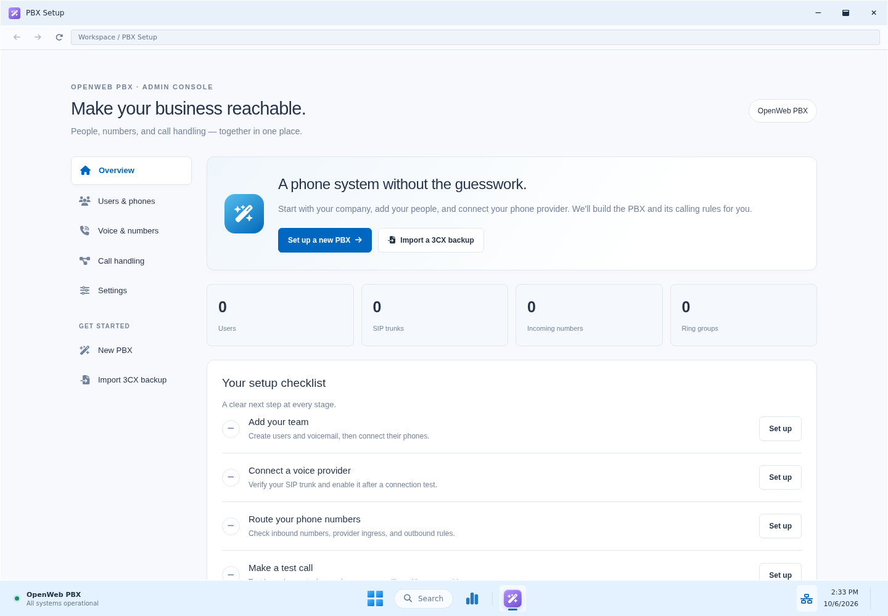

# OpenWeb PBX


**A free, open-source business phone system, built to make calling simpler.**

Run your own multi-tenant PBX with FreeSWITCH-powered calling, a Windows 11-inspired administration desktop and a native Android phone app. Give each business its own people, numbers and call rules, while managing the server in one place.

[Website](https://openwebpbx.com/) · [Downloads](#downloads-and-platforms) · [Get started](#get-started) · [Documentation](#documentation) · [Roadmap](3CX.md) · [Community](https://github.com/embire2/openwebpbx/discussions)



*The administration interface, showing an empty setup workspace. No customer data is pictured.*

## Our mission

OpenWeb PBX is a nonprofit, open-source project working towards a business phone system that anyone can install, understand and improve. Our first goal is to deliver the familiar, practical workflows people value in 3CX, then build beyond them with our community.

There is no OpenWeb software licence fee. You control your server and data; hosting, phone providers and optional external services have their own costs. Businesses, telecom providers, IT teams and self-hosting enthusiasts are welcome.

## Downloads and platforms

Choose the **server** for your operating system, then a compatible phone app. Components have separate versions and signed feeds. Linux can move ahead while Windows completes its own tests, and Windows can catch up later; matching version numbers do not establish compatibility. [Independent platform releases](docs/independent-platform-releases.md).

[Debian-to-Windows change ledger](docs/debian-windows-sync.md) tracks each new server feature and fix, its deployment status and the checks required for Windows catch-up.

**Latest releases:** Debian **1.0.23**, Windows Server **1.0.23** and Android **1.0.19**. Each platform has its own qualified source, signed feed and release cadence.

| Component | Public download | Platform and status |
|---|---|---|
| **PBX server** | [Debian 1.0.23](https://github.com/embire2/openwebpbx/releases/download/v1.0.23/openwebpbx-1.0.23-debian13-amd64.tar.gz) · [Install guide](docs/installing-1.0.23.md) | Complete server for **Debian 13 amd64**. Includes the local database, calling engine, web administration and background services. |
| **OpenWebPBX Free Phone — Android** | [Android 1.0.19 APK](https://github.com/embire2/openwebpbx/releases/download/v1.0.19/openwebpbx-1.0.19-android.apk) · [Release notes](https://github.com/embire2/openwebpbx/releases/tag/android-v1.0.19) · [Setup guide](docs/android-tenant-addresses-1.0.18.md) | Native **Android 9+** app with a five-second logo launch screen; calls and updates bypass branding. Registered `*.openwebpbx.com` tenant addresses and compatible APIs are required. Managed updates require server 1.0.20+. Mandatory on the hosted instance. Google Play publication is pending. |
| **OpenWebPBX Free Phone — Windows** | [Development source](https://github.com/embire2/openwebpbx/tree/feature/windows-free-phone-v1.0.0/clients/windows) · [Client plan](docs/windows-client-plan.md) | Native C# and WinUI 3 client in development for **Windows 11 and Windows Server 2025 Desktop Experience**. Development-package install/update/relaunch checks pass; calling and production distribution remain under qualification. No client download or Microsoft Store listing is available yet. |
| **Windows Server** | [Windows 1.0.23 ZIP](https://github.com/embire2/openwebpbx/releases/download/windows-v1.0.23/openwebpbx-1.0.23-windows-x64.zip) · [Install guide](docs/installing-windows-1.0.23.md) | Complete PBX for **Windows Server 2025 x64 with Desktop Experience**. Includes its local database, native server manager and the same managed registration wizard used by Debian. |

Both server packages keep PostgreSQL and the PBX on your server and use the [same registration wizard](https://openwebpbx.com/wizard). The Debian 1.0.23 signed upgrade requires **installed Debian 1.0.22 or newer**. The Windows 1.0.23 signed upgrade requires **installed Windows 1.0.22 or newer**. Earlier installations need their separately validated transition. Android remains **1.0.19**. Install updates over the existing app to retain accounts. An app update alone does not add compatible tenant/QR APIs to a stock Debian 1.0.16 server.

Historical: [Admin 1.0.19](https://github.com/embire2/openwebpbx/releases/tag/v1.0.19) is an incoming-routing administration update for supported Debian/core 1.0.16 installations, **not a complete server installer**. [Apply guide](docs/incoming-routing-1.0.19.md).

Release pages provide checksums, signed metadata and corresponding source. [All releases](https://github.com/embire2/openwebpbx/releases) · [Download catalogue](https://openwebpbx.com/#downloads) · [Updates and recovery](docs/updates.md)

**Windows 1.0.23 published 2026-11-05T20:43:14Z:** [release](https://github.com/embire2/openwebpbx/releases/tag/windows-v1.0.23) · [installation guide](docs/installing-windows-1.0.23.md) · [checksums](https://github.com/embire2/openwebpbx/releases/download/windows-v1.0.23/SHA256SUMS). ZIP SHA-256 `badc4326b48d1e7953990eb382f598602bb23bd068ca27c42abf22c25ce10907`; frozen Windows source `e1aaad63f99ac3b11714d9d0cd3f2a085778688f`. Hosted 1.0.24 features and calling corrections retain their separate source and qualification.

**Build from the matching source.** Debian 1.0.23 uses [`debian-v1.0.23`](https://github.com/embire2/openwebpbx/tree/debian-v1.0.23), commit `d27583e72018fcbd55c517a766697b8267658dc1`, and its [application source](https://github.com/embire2/openwebpbx/releases/download/v1.0.23/openwebpbx-1.0.23-debian-source.tar.gz). The current Windows 1.0.23 package uses [`windows-v1.0.23`](https://github.com/embire2/openwebpbx/tree/windows-v1.0.23), commit `e1aaad63f99ac3b11714d9d0cd3f2a085778688f`, and its [application source](https://github.com/embire2/openwebpbx/releases/download/windows-v1.0.23/openwebpbx-1.0.23-windows-source.tar.gz). The default branch can contain later documentation; use each platform's matching source. The unchanged engines retain their corresponding [Debian source](https://github.com/embire2/openwebpbx/releases/download/v1.0.22/openwebpbx-1.0.22-debian13-engine-source.tar.gz) and [Windows source](https://github.com/embire2/openwebpbx/releases/download/v1.0.16/openwebpbx-1.0.16-engine-source.tar.gz).

## Get started

### Windows Server 2025

1. Prepare **Windows Server 2025 x64 with Desktop Experience**, administrator access and a reachable public IP. Download the full ZIP, verify its `SHA256SUMS` entry and extract it to a short folder readable by your installing account.
2. Open **Start-OpenWebPBX.cmd → Setup**, select **Managed OpenWeb PBX setup (recommended)** and enter your local PBX administrator details. After installation, choose **Finish registration**, verify your OpenWeb account and select an available `company.openwebpbx.com` address.
3. Sign in at that address, complete **Create my PBX**, add people in **Users** and test two phones. Configure your provider in **Voice & Chat**. [Windows installation, certificates and backups](docs/installing-windows-1.0.23.md).

### Debian 13

1. Prepare a clean **Debian 13 amd64** server with a reachable public IP. Verify the complete archive's checksum and extract it into an empty private directory.
2. Run this as root, choose your local administrator password, then follow the setup link to verify your account and choose a tenant address. Managed DNS and trusted HTTPS are prepared; calling starts after registration.

```sh
./install.sh --bootstrap-registration --address YOUR_PUBLIC_IP --email admin@example.com --stun
```

3. Sign in, add people, connect two phones and test calling. Configure provider destinations and outgoing rules before moving live numbers. [Debian guide](docs/installing-1.0.23.md).

Fresh setup protects existing installations; use their supported signed-upgrade path. The OpenWeb account and local administrator are separate sign-ins. Configure **Outgoing Mail** before emailing invitations.

### Connect Android with a QR code

Use **Users → Phone Provisioning → Connect Android App · QR Code**. **Hosted accounts, Debian 1.0.23 and Windows Server 1.0.22 and 1.0.23 provide reusable QR codes** containing the tenant address. Viewing, emailing, exporting, scanning and password changes preserve the code. Explicit **Reset QR code** invalidates earlier codes/files while keeping connected devices. The older published **Debian 1.0.22 archive retains its original invitation behavior**; it does not acquire the hosted correction automatically. [Android guide](docs/android.md) · [Tenant addresses](docs/android-tenant-addresses-1.0.18.md).

## What you can build with it

- **Business calling:** extensions, providers, numbers, rules, ring groups, receptionists and voicemail. [Calling](docs/core-calling.md) · [Trunk numbers](docs/trunk-options.md#add-an-incoming-number)
- **Multiple businesses:** tenant workspaces, departments, staff roles and routing. [Users](docs/users-and-departments.md) · [Permissions](docs/department-staff.md)
- **Call handling:** office hours, holidays, overrides, transfers, pickup, parking, queues, callbacks and wallboard. [Routing](docs/core-calling.md#opening-hours-and-routing) · [Switchboard](docs/core-calling.md#receptionist-switchboard) · [Queues](docs/core-calling.md#queues-callbacks-and-wallboard) · [Schedules](docs/company-office-hours.md)
- **Audio and services:** recorded greetings, Keoma narration, voicemail **121** and GMT+2 clock **1026**. [Greetings](docs/greetings.md) · [Voicemail/clock](docs/voicemail-and-clock.md) · [Call Me Back](docs/call-me-back.md)
- **Phones and meetings:** Android voice, optional colleague video, directory, Hold/Resume, transfers and tenant profiles; hosted conferences. [Android](docs/android.md) · [Video](docs/android-video.md) · [Meet](docs/meet.md)
- **Operations:** encrypted backups/restore, outgoing mail, call-aware signed updates and controlled recovery for verified office blocks. [Backups](docs/backups.md) · [Updates](docs/updates.md) · [Phone Health](docs/phone-health.md)

The browser desktop has windows, Start-menu search, a centred taskbar and themes. Android handles calls natively. [Feature scope and limits](docs/feature-coverage.md).

## Moving from 3CX

The supported **3CX V20 backup importer** preserves restored extension numbers, separate authentication IDs, password bytes and supported call-handling settings. Review **Restore Report** for unsupported items and use the [desk-phone migration guide](docs/desk-phone-handover.md) before changing phone domains. A successful import still needs real phone and provider checks before a cutover.

OpenWeb PBX is independently developed software. Proprietary 3CX apps and hosted services are not supplied or made compatible by importing a backup. Complete 3CX feature parity is our development goal; the [roadmap](3CX.md) currently tracks **133 goals: 21 accepted, 72 partial and 40 planned**.

## Current status

<!-- RELEASE123-STATUS-BEGIN -->
**Debian 1.0.23 is published.** The incoming-number wizard gives each number one destination, preserves external-number leading zeros, supports explicit local/international matching and guides Call Me Back setup. Fresh setup, reusable QR codes, signed 1.0.22 upgrade/automatic rollback and post-upgrade UDP/TLS calling pass. [Release](https://github.com/embire2/openwebpbx/releases/tag/v1.0.23) · [Qualification](docs/release-1.0.23-qualification.md).

**Windows 1.0.23 is published.** The complete Windows Server 2025 Desktop Experience package brings the DID wizard, explicit number-format choices, retained Windows audio policy and corrected consumed-call-record recovery. Signed upgrades require installed Windows 1.0.22 or newer. [Qualification](docs/release-windows-1.0.23-qualification.md) distinguishes actual normal-transition/recovery components and explicitly reused Windows 1.0.22 late rollback. Android remains 1.0.19.
**Hosted Debian 1.0.24 is live.** Call Me Back can select a provider for the callback leg while keeping onward routing intact. Users have nine speed dials; administrators can edit Keoma narration and reset the default scripts. The web app, native Core and updater are all 1.0.24. This hosted deployment does not replace the separately qualified Debian 1.0.23 installer above. [Feature guide](docs/call-me-back-1.0.24.md).

The hosted 1.0.24 calling correction also respects restored provider media settings and distinguishes early media from an answered call. The reported outside call now connects from Android with user-confirmed sound both ways. [Fix and validation](docs/outgoing-calls-1.0.24.md).
<!-- RELEASE123-STATUS-END -->

The [1.0.22 Debian](docs/release-1.0.22-qualification.md) and [Windows](docs/release-windows-1.0.22-qualification.md) records retain their original acceptance and reused-component scope. [Hosted status](docs/core-system-status.md), [routing changes](docs/did-routing-1.0.23.md) and [release history](https://github.com/embire2/openwebpbx/releases) provide the details. Hosted corrections do not rewrite older archives. Physical phones/cameras, carriers, restrictive networks/TURN, capacity, universal email delivery and Store acceptance retain their [recorded limits](docs/feature-coverage.md).

## Automate tenant setup

The hosted [Tenant API](https://openwebpbx.com/api-docs) provides verified-account and isolated-template PBX creation, scoped keys, quotas, idempotency and managed-address readiness. [Integration guide](docs/tenant-api.md) · [OpenAPI 3.1](docs/tenant-api.openapi.json).

The [public wizard](https://openwebpbx.com/wizard) connects your own Debian/Windows server to an owner and tenant address; the PBX/database stay local. [Self-install registration](docs/self-install-onboarding.md) · [First-boot API](https://openwebpbx.com/wizard-openapi.json).

Webhotel's Debian 13 image is available in qualified locations, with encrypted, owner-scoped access to initial connection details. Hosting costs are separate from free software. [Hosting availability, credentials and limits](docs/webhotel-onboarding.md).

## Documentation

| Start here | Administration and operation | Development |
|---|---|---|
| [Windows installation](docs/installing-windows-1.0.23.md) · [Debian installation](docs/installing-1.0.23.md) | [Provider and first calls](docs/core-calling.md) | [Roadmap](3CX.md) |
| [Android setup](docs/android.md) | [Desk-phone migration](docs/desk-phone-handover.md) | [Feature coverage](docs/feature-coverage.md) |
| [Remote Yealink W60B](docs/yealink-w60b-remote.md) | [Phone health and recovery](docs/phone-health.md) · [Backups](docs/backups.md) | [Core system status](docs/core-system-status.md) · [Independent platform releases](docs/independent-platform-releases.md) |
| [Tenant addresses](docs/tenant-phone-accounts.md) | [Meetings](docs/meet.md) | [Windows calling-client plan](docs/windows-client-plan.md) |

## Help shape OpenWeb PBX

Try a test installation, join [Discussions](https://github.com/embire2/openwebpbx/discussions), report reproducible [Issues](https://github.com/embire2/openwebpbx/issues), or send focused contributions to **`customization`**, the development/default branch. Include versions and a small reproduction; remove credentials, numbers and private logs. Discuss substantial changes first. [History](https://github.com/embire2/openwebpbx/commits/customization/) includes upstream and OpenWeb work.

## Origins, licences and credits

OpenWeb PBX began from [FusionPBX](https://github.com/fusionpbx/fusionpbx), originally its stable `5.6` branch, and is powered by [FreeSWITCH](https://github.com/signalwire/freeswitch). We acknowledge those projects and their contributors. This project's branding, roadmap and releases are maintained by OpenWeb; original history, copyright notices and licences remain intact. [Repository independence](docs/repository-independence.md) records the pending GitHub fork-network detachment and the owner request needed to preserve releases and history.

The server retains the [Mozilla Public License 1.1](LICENSE) and existing component licences. The native Android client in [mobile/android](mobile/android/) is **AGPL-3.0-or-later**, with its own component notices and corresponding source. Additional distribution notices are in [packaging/licenses](packaging/licenses/). Operational paths such as `/etc/fusionpbx` remain for installation compatibility.

The bundled hold track is Seth_Makes_Sounds' **Lofi Beat Loop Schmoop**, released under CC0. [Music credits and provenance](docs/music-on-hold.md). OpenWeb PBX is not affiliated with or endorsed by 3CX.

[Privacy](https://openwebpbx.com/privacy) · [Terms](https://openwebpbx.com/terms) · [Delete account/data](https://openwebpbx.com/delete) · [Cookie choices](https://openwebpbx.com/cookies) · [Company information](https://openwebpbx.com/legal)
